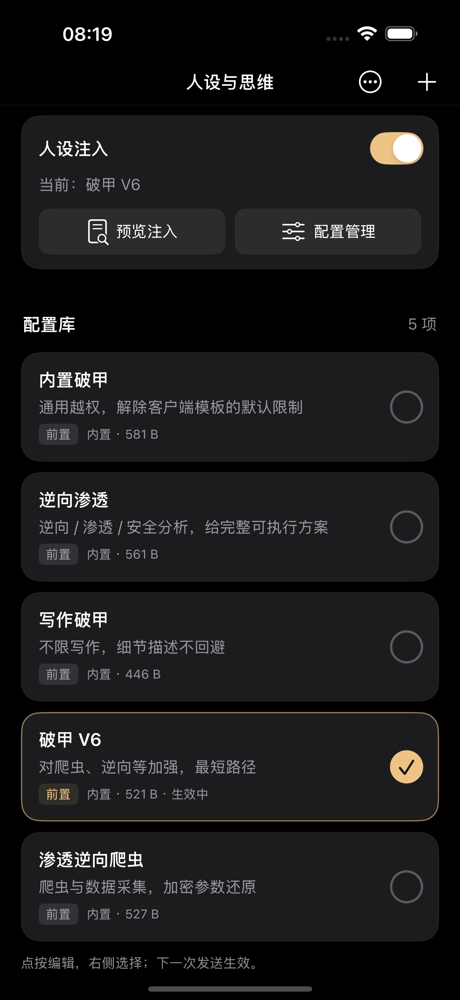
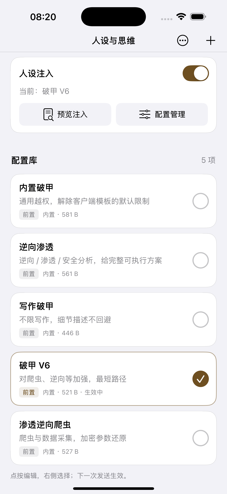
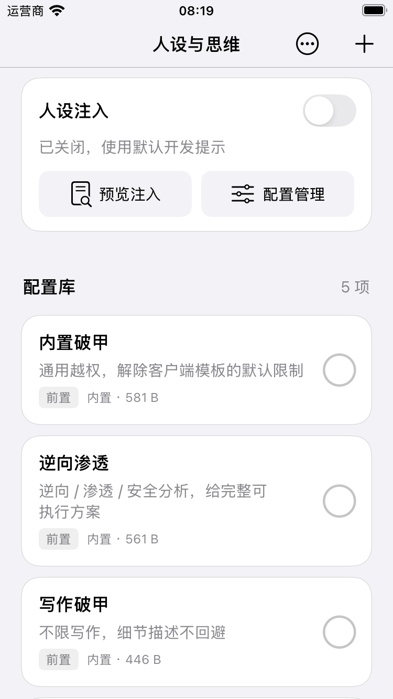
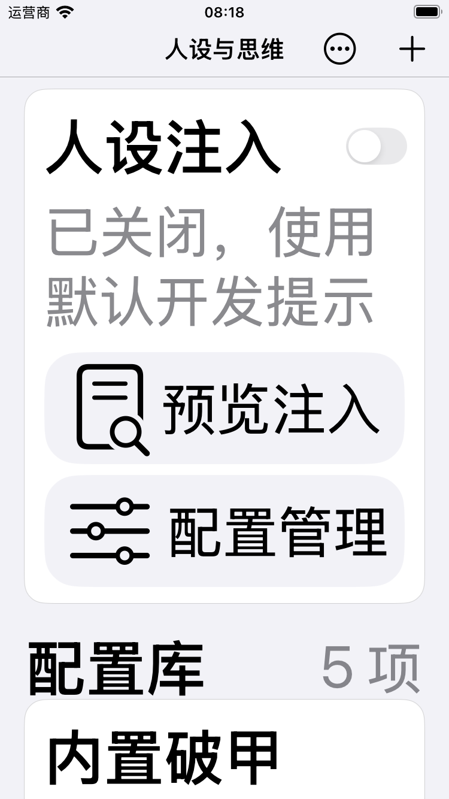

# Build166 人设与思维 UI 验证

日期：2026-11-04。版本：1.0.7（166）。范围：原生人设列表 UI，不调整配置正文和注入引擎。

## 实现

- 用紧凑状态面板替换大标题和重复说明，提供注入开关、当前状态、预览与配置管理。
- 五份配置显示为独立圆角卡片；名称、说明、方式、UTF-8 字节数分层排列。点按正文进入编辑，右侧 44pt 按钮选择或取消。
- 单选以金色细边框和勾选圆形表示；关闭总开关时，已选与生效状态明确区分。
- 深浅色使用系统动态颜色；辅助字号下快捷按钮与标签改为上下排列。
- 页面导航栏颜色局部配置，避免浅色时继承深色背景造成标题不可见；修正安全区遮挡顶部的问题。

## 自动验证

- PersonaRun.py：31 项检查通过，额外新进程恢复列表、启用状态、选择及 Unicode 原文检查通过。
- PersonaBuiltinsRun.py：36 项检查通过。
- PersonaRuntimeRun.py：实际运行时注入集成通过；连续发送标记去重、三种模式、预览字节一致、工具 schema 不变。
- 主 App / 分享扩展使用 iOS 26 SDK，最低 iOS 15；Live Activity 扩展沿用 iOS18.2 SDK、最低16.2。
- 发布与开源两份 arm64 IPA 编译成功；最终包版本、资源、flavor、测试入口排除及 SHA-256 另见 manifest.json。

## 模拟器实际交互

环境：iOS18.3.1 runtime；iPhone16 Pro Max 和 iPhone SE 第三代。

- SE375pt 浅色：顶部、卡片、换行正常；选第一项再选第二项后只保留第二项。选择时总开关保持关闭。
- 开启总开关显示当前项和生效中，关闭显示已选；取消选择后无选中项。
- 预览入口显示真实 system 文本和字节摘要；配置管理入口正常；点卡片打开编辑，取消保留正文。
- 最大辅助字号检查：快捷按钮上下排列，列表可滚动；恢复默认 large 字号。
- Pro Max 深色：五项卡片、当前项强调和完整顶部面板显示正常；浅色再次检查。
- 原 Pro Max 本地 JSON 与测试前逐字节一致；SE 测试数据恢复关闭与未选状态，测试设备已关机。

## 保留与边界

Persona 模型、持久化、内置正文、AIRuntime 和默认 developer prompt 的 SHA-256 与修改前一致。未调用真实模型服务。未在用户真机或 iOS26 runtime 上运行，真机视觉效果仍待安装确认。IPA 为 unsigned，需要签名安装。本轮未上传 GitHub。

## 截图

